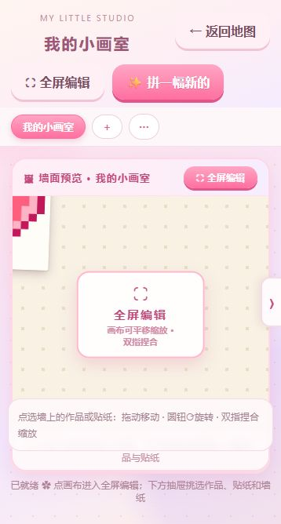

# 拼了个豆

> 把错位的小豆子拼回原处，让像素画一点点亮起来。

一款支持手机、平板和电脑浏览器的像素拼豆益智游戏。内置 **1000+ 关（当前 1018 关）**，支持上传图片自由创作、装饰作品墙和导出分享卡，可通过 Node.js 或 Docker 自托管。

[快速部署](#快速部署) · [开发者部署](#开发者部署) · [Docker 部署](#docker-部署) · [数据与备份](#数据与备份) · [贡献](#贡献)

## 界面预览

<table>
  <tr>
    <td align="center"><br>关卡地图</td>
    <td align="center"><br>我的小画室</td>
  </tr>
</table>

截图来自本地运行的应用，展示效果取决于设备尺寸和游玩进度。

## 功能特点

- **1000+ 关像素图案**：从爱心、水果到动物与风景，配合渐进难度、星级目标和特殊格子。
- **点豆浮起、点孔归位**：点击错位豆子让同色的一组浮起，再点同色空孔或空槽决定去向；设置里的「自动填豆」可省掉点空孔这一步；闯关默认锁住 2 个空槽，开启后最多 2 星。
- **道具与小精灵**：7 种常驻道具、7 种隐藏道具，以及可以互动、许愿的小精灵啵啵。主页连点啵啵 3–6 下可随机掉道具，或把某个未三星通关的关卡直接变三星（特效 + 彩纸，不触发扭蛋机）；一个周期 3 次奖励，两次间隔 ≥25 秒，3 次后冷却 5 分钟。
- **三星目标已放宽**：连击要求上限 18、开新链目标更宽松；游戏内顶部实时显示每项要求的 ✓ / ✗ 达成状态。
- **自由创作**：上传 JPG、PNG、WebP，在浏览器内转换为像素拼豆图案，调整尺寸与配色后开始游玩。
- **我的小画室**：多面作品墙、相框、贴纸、墙纸与可缩放画布，收藏和布置完成的作品。
- **分享卡导出**：选择主题、编辑文案，导出 PNG 图片。
- **进度保存**：服务端 SQLite 存储，浏览器缓存辅助；普通关卡与自由创作支持中断存档。

## 快速部署

已有 Docker 和 Compose 的 Linux 主机可直接运行：

```bash
git clone https://github.com/nlizzard/pin-le-ge-dou.git
cd pin-le-ge-dou
sudo mkdir -p /home/a123/docker_data/pin_le_ge_dou
docker compose up -d --build
```

在浏览器打开 **http://localhost:3000**；其他设备访问 `http://服务器IP:3000`。完整配置、升级和备份方法见下文。

## 怎么玩

**操作**：点一颗放错的豆子，它和连着的同色错位豆子会一起浮起来；再点一个同色空孔，豆子就填进去（点到不同颜色的孔会提示「要放在相同颜色孔上哦」）。没有同色空孔时，点下方空槽把浮起的豆子放进空槽；之后点空槽里的豆子、再点同色空孔就能拿出来。一片颜色拼完会扫过一道高光。

**自动填豆（设置里的玩法糖，默认开）**：点到的豆子已有同色空孔时直接飞过去，省掉点空孔这一下；要进空槽的豆子始终由玩家点空槽决定，空槽里的豆子也不会自己飞出来。

**锁住的空槽**：闯关时最后 2 个空槽默认锁住（容量 4–5 时锁 1 个），点它可以开启，开启后本关最多 2 颗星。

1. 点击关卡卡片进入游戏，观察凸起的错位豆子和棋盘空位。
2. 点击一颗错位豆子，相连的同色错位豆子会一起浮起；再点一下它们就放回原处。
3. 点同色空孔归位，或点空槽暂存；空槽放不下整组时按规则分批放入，空槽里的豆子要点它才会出来。
4. 在暂存槽满之前完成图案，合理使用道具、加时与撤回。

限时通关获得 1 星，完成额外目标可以获得最多 3 星；超时后仍可继续，完成获得半星。自由创作不限时，道具免费使用。

| 操作 | 手机 / 平板 | 电脑 |
| --- | --- | --- |
| 选择豆子 | 点按 | 鼠标点击，悬停预览 |
| 缩放 | 双指捏合、滑条（点击不会自动放大） | 滚轮、`+` / `-`、滑条 |
| 平移 | 单指拖动 | 拖动、方向键 / WASD |
| 复位视图 | ⌖ 按钮 | ⌖ 按钮、`0` |
| 查找空位 | 连点 ⌖、点需求色条 | `Tab` |
| 使用道具 | 下方道具栏 | 道具栏、数字键 `1`–`7` |
| 查看道具说明 | 长按道具 | 悬停或长按 |
| 暂停 / 设置 | ⏸ | `Esc` |

## 开发者部署

### 环境要求

- Node.js **22.13+（22.x）**，服务端使用内置 `node:sqlite`；Docker 镜像采用 Node.js 22。
- npm；项目同时提供 Yarn 4 锁文件，使用 Yarn 时请保持同一套包管理方式。
- Git。

### 源码运行（3000 端口）

```bash
git clone https://github.com/nlizzard/pin-le-ge-dou.git
cd pin-le-ge-dou
npm ci
npm start
```

`npm start` 会生成关卡、构建前端并启动服务。访问 **http://localhost:3000**，前端页面和 API 由同一个服务提供。首次生成全部关卡可能需要一些时间。

也可以分开构建和启动，便于在服务器上管理进程：

```bash
npm run build
node server/index.js
```

需要长期运行时，可交由 systemd 等进程管理工具托管 `node server/index.js`，工作目录设为项目根目录。

### 热更新开发

```bash
npm ci
npm run dev
```

此模式下，前端开发页面在 **http://localhost:5173**，API 在 `3000` 端口，Vite 会代理 `/api` 请求。修改代码时使用此模式；普通源码部署和 Docker 部署都访问 `3000`。

### 常用命令

| 命令 | 用途 |
| --- | --- |
| `npm run dev` | 启动前端热更新与服务端监听 |
| `npm run build` | 生成关卡并构建前端 |
| `npm start` | 构建后启动完整应用，默认端口 3000 |
| `npm run serve` | 重新生成关卡后启动服务，不重新构建前端 |
| `npm run typecheck` | TypeScript 类型检查 |
| `npm test` | 运行自动化测试 |
| `npm run build:levels` | 生成服务端使用的关卡定义 |

## Docker 部署

### 启动

安装 Docker Engine 与 Compose 插件后，在项目根目录执行：

```bash
sudo mkdir -p /home/a123/docker_data/pin_le_ge_dou
docker compose up -d --build
docker compose ps
docker compose logs -f --tail=100
```

仓库中的 `docker-compose.yml` 默认配置：

```yaml
services:
  pin-le-ge-dou:
    build: .
    image: pin-le-ge-dou:latest
    ports:
      - "3000:3000"
    volumes:
      - /home/a123/docker_data/pin_le_ge_dou:/data
    environment:
      - ACCESS_KEY=
    restart: unless-stopped
```

访问 `http://服务器IP:3000`。镜像在构建时生成关卡和前端文件，运行容器无需再安装开发依赖。

- **数据目录**：宿主机 `/home/a123/docker_data/pin_le_ge_dou` 对应容器 `/data`。请按实际主机修改左侧路径，并确保目录可写。
- **端口**：如需使用宿主机 8080 端口，将映射改为 `"8080:3000"`，随后访问 `http://服务器IP:8080`。
- **访问口令**：需要限制访问时，将 `ACCESS_KEY=` 改成自己的口令，再重新创建容器。通过公网访问时建议使用 HTTPS 反向代理。
- **健康检查**：`/healthz` 返回服务健康状态，镜像已配置 Docker 健康检查。

### 升级

先按下节备份数据，确认工作区没有待处理改动后执行：

```bash
git pull --ff-only
docker compose up -d --build
docker compose logs --tail=100
```

保留相同的数据挂载目录即可继续读取存档。关卡内容更新后，服务端会重新导入关卡定义，不会因此清空用户进度；新增关卡仍需保持旧关卡编号稳定，避免进度对应到不同图案。

## 数据与备份

| 运行方式 | 默认数据库位置 |
| --- | --- |
| 源码运行 | `项目目录/data/pin-le-ge-dou.db` |
| Docker 容器内 | `/data/pin-le-ge-dou.db` |
| 当前 Compose 对应的宿主机 | `/home/a123/docker_data/pin_le_ge_dou/pin-le-ge-dou.db` |

数据库保存关卡定义、闯关进度、星级、背包、设置、创作用时、作品墙与中断存档。数据库文件名和浏览器存储键统一使用 `pin-le-ge-dou`。升级时会自动复制旧版数据库和迁移浏览器缓存，旧数据库保留作备份；升级前请停止旧服务并备份数据目录。

从旧名称版本升级时，先在更新代码前执行 `docker compose down` 停止旧服务，再更新代码并重建；服务名与镜像名均已改为 `pin-le-ge-dou`。原数据挂载路径保持不变。

**全新空目录首次启动时包含内置关卡，没有历史游玩存档。** 从源码部署迁移到 Docker 时，先停止原服务，把原 `data` 目录内容完整复制到挂载目录，再启动容器。

### 停机备份（Linux / Docker）

SQLite 使用 WAL 模式，运行时不能仅复制 `.db` 文件。最直接的文件备份方式是停止服务后完整备份数据目录：

```bash
docker compose stop
sudo tar -czf "pin-le-ge-dou-backup-$(date +%Y%m%d-%H%M%S).tar.gz" \
  -C /home/a123/docker_data pin_le_ge_dou
docker compose start
```

确认备份命令成功后再启动服务，并将备份另存到其他磁盘或主机。恢复时先停服务，保留当前目录副本，再把备份恢复到同一挂载路径。挂载可让数据跨容器重建保留，但无法替代备份。

### 多设备与多人访问

当前没有独立用户账号，**同一服务实例的访问者共享服务端存档**。口令只控制访问，不能隔离玩家。适合个人多设备或亲友共享体验；需要独立进度时，应分别部署实例并使用不同的数据目录与端口。

浏览器保留本地缓存，但尚未同步到服务端的数据不能通过服务器备份恢复。上传图片的像素化处理在浏览器内完成；保存作品和中断进度时，相关像素数据会同步到服务端。

## 配置

| 环境变量 | 默认值 | 说明 |
| --- | --- | --- |
| `PORT` | `3000` | 服务监听端口 |
| `DATA_DIR` | 源码为 `./data`，镜像为 `/data` | 数据库存储目录 |
| `ACCESS_KEY` | 空 | API 访问口令，空表示不启用 |
| `LOG_LEVEL` | `info` | 服务日志级别 |

Docker 修改容器内部的 `PORT` 时，需要同步调整端口映射与 Dockerfile 中的健康检查地址。通常只修改映射左侧的宿主机端口即可。

## 添加关卡

额外图案存放在 `levels/*.json`，格式和来源字段见 [关卡文档](levels/README.md)。图案会参与构建并生成服务端关卡定义。

```bash
# 将图片转换为关卡，并生成预览
npm run art:pixelize -- ./my-image.png --size 24 --colors 8 --name 小狗 --preview

# 重新构建，然后重启服务
npm run build
```

Docker 部署则执行 `docker compose up -d --build`。新增图案时请保持已有图案的 key、关卡顺序与编号稳定，并核查素材授权；修改旧关卡布局时也应考虑中断存档的兼容性。

## 项目结构

```text
client/              前端页面与样式
  src/core/          规则引擎、关卡生成、图案与道具
  src/render/        棋盘渲染、缩放、特效与精灵
  src/ui/            关卡地图、游戏、小画室与分享
server/              Fastify 静态托管与 SQLite API
  generated/         构建生成的关卡定义
levels/              额外图案与来源记录
tools/               关卡生成、图片像素化与素材工具
tests/               自动化测试
docs/images/         README 示例截图
Dockerfile           多阶段容器构建
docker-compose.yml   端口、数据挂载与运行配置
```

技术栈：TypeScript、Vite、Canvas、Fastify、SQLite。

## 贡献

欢迎通过 [Issues](https://github.com/nlizzard/pin-le-ge-dou/issues) 反馈问题、提出建议，或提交 Pull Request。

- 报告问题时请提供复现步骤、浏览器与设备信息，必要时附截图；请勿上传个人存档或访问口令。
- 修改规则或存储逻辑时，补充相关验证，提交前运行 `npm run typecheck`、`npm test` 和 `npm run build`。
- 贡献图案时附上来源、作者和许可证信息，避免导入未获授权的素材。

## 素材与许可

第三方图案来源与许可记录见 [levels/credits.json](levels/credits.json) 及各关卡文件，素材的使用范围以原作者授权为准。仓库目前未提供统一的代码 LICENSE 文件；如需再分发或商业使用，请先与维护者确认授权。

分享卡可在用户点击后请求[一言接口](https://developer.hitokoto.cn/sentence/)获取随机短句；失败时使用内置文案，不影响游戏。
